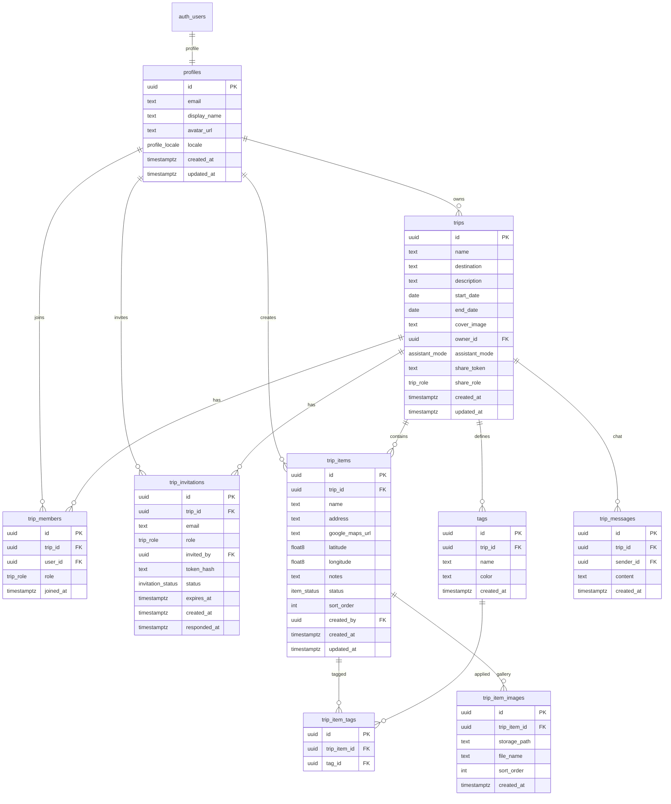

# Wanderlist — Architecture Overview

Wanderlist is a collaborative trip planner built with React, TypeScript, Vite, Tailwind CSS and Supabase.
It lets travelers collect places, organize them with tags and photos, and plan together in real time.

## 1. Goals

- A friendly, pastel, mobile-first planning experience (not a corporate dashboard).
- A functional MVP first: social auth, trips, members, share links, places, tags, images, avatars, maps links, chat, assistant, i18n, realtime.
- Security enforced in PostgreSQL (RLS + triggers + SECURITY DEFINER RPCs), never only in the browser.
- Feature-based frontend architecture with strict TypeScript and no `any`.

## 2. High-level architecture

```
┌──────────────────────────── Browser ─────────────────────────────┐
│ React 19 + Vite + TypeScript                                     │
│                                                                  │
│  app/          providers, router, app shell                      │
│  features/     auth, trips, members, sharing, items, tags,       │
│                images, avatars, chat, assistant                  │
│  components/   design-system (ui) + shared compositions          │
│  lib/supabase  typed client, generated-style database types      │
│  services/     google-maps (Phase 1 URL builder / Phase 2 seam)  │
└───────────────┬──────────────────────────────────────────────────┘
                │ supabase-js (anon key only)
                ▼
┌────────────────────────────── Supabase ──────────────────────────┐
│ Auth (Google/GitHub OAuth, sessions)                             │
│ PostgREST (RLS-protected tables + RPCs)                          │
│ PostgreSQL (schema, triggers, helper functions)                  │
│ Storage (private `trip-images` + `avatars`, signed URLs)         │
│ Realtime (postgres_changes on trip and chat tables)              │
│ Edge Function `trip-assistant` (Basic/Gemini assistant)          │
└──────────────────────────────────────────────────────────────────┘
```

## 3. Frontend layout

```
src/
  app/
    app.tsx                 – providers + routes
    providers/              – QueryClient, AuthProvider, Toaster
    router/                 – protected routes, route table
  components/
    ui/                     – buttons, inputs, modal, avatar, badges, states…
    shared/                 – AppShell, AuthShell, Logo, CoverImage, ViewToggle
  features/
    auth/                   – context, api, schemas, pages, profile, callback
    trips/                  – dashboard, trip CRUD, detail + settings pages
    trip-members/           – member list, roles, ownership transfer
    sharing/                – share-link creation, rotation, public join
    trip-items/             – place list/cards, filters, DnD, place modal
    tags/                   – tag CRUD, manager, multi-select, colour contrast
    images/                 – compression, upload, signed URLs, lightbox
    avatars/                – private profile avatar upload and signed URLs
    chat/                   – realtime trip chat and deduplication
    assistant/              – Basic/Gemini modes and trip suggestions
  i18n/                     – EN/VI dictionaries, provider, date locale
  hooks/                    – cross-feature hooks (realtime)
  lib/
    supabase/               – typed client, Database types
    env.ts, query-keys.ts, constants.ts
  services/
    google-maps.ts          – Phase 1 URL builder (isolated)
  types/                    – shared domain unions
  utils/                    – cn, dates, errors, tags, image compression
```

Every feature owns its **API functions, TanStack Query hooks, schemas, types and components**.
UI primitives never import features; features may import UI/shared.

## 4. State management

| State                | Owner                                   |
| -------------------- | --------------------------------------- |
| Auth session         | `AuthProvider` (Supabase listener)      |
| Server data          | TanStack Query cache                    |
| Forms                | React Hook Form + Zod                   |
| Filters/search/view  | Local component state (URL not required)|
| Language             | `I18nProvider` + `profiles.locale`      |
| Theme                | `ThemeProvider` + localStorage          |
| Realtime invalidation| `useTripRealtime` channel per trip      |

Realtime is used as a **cache invalidation signal**, not a state store. PostgreSQL remains the source of truth.

Trip chat uses a private Realtime Broadcast channel for throttled, ephemeral typing signals. PostgreSQL stores messages, mentions, read positions, and notification preferences. RLS protects tables and the Broadcast topic. `send_trip_message` commits a message and its mention recipients together. Authors may edit chat messages for 15 minutes through `edit_trip_message`, which updates content and mention recipients in one transaction; a trigger stamps `edited_at` and rejects identity changes. Authors can delete a new message during that window to clean up a failed attachment upload; a delete trigger also removes its chat notifications. The message list loads the newest 200 rows and displays them in chronological order.

The trip feed uses `trip_posts`, `trip_post_images`, `trip_post_reactions`, and `trip_post_comments`. Every member may post and react. Authors edit their own content; the owner may remove content and pin posts. Images use private `trip-images` paths under `<trip_id>/posts/`. Database triggers create `trip_notifications` for relevant activity, visible only to their recipient. The UI uses `?tab=plans|feed|chat` so notifications deep-link to the right section.

## 5. Data access strategy

- Base tables are queried with `select('*')` against a hand-written, generated-style `Database` type.
- Aggregate shapes (trip cards, members with profiles, items with tags/images) are composed
  in feature API functions from small, RLS-safe queries. This avoids fragile nested-select typing.
- Storage is **private**. Trip images and profile avatars are displayed with short-lived signed
  URLs so storage RLS is enforced.
- All privileged operations (share-link join, ownership transfer, role changes, reordering) are
  RPCs with server-side permission checks.
- The Gemini assistant calls the `trip-assistant` Edge Function; Basic mode stays entirely local.

## 6. Database ERD



### Integrity rules

- `trip_members` unique `(trip_id, user_id)`; exactly one `owner` per trip (partial unique index).
- `trips.share_token` is nullable and unique; clearing or rotating it revokes the old link.
- `trip_invitations` is written only by the `invite-member` Edge Function. It sends email when Resend secrets are configured and otherwise returns a seven-day invite link. Invitation responses use SECURITY DEFINER RPCs.
- `tags` unique `(trip_id, lower(name))`.
- `trip_item_tags` unique `(trip_item_id, tag_id)` and a trigger guarantees the tag and item share a trip.
- `trip_item_images` and `trip_item_tags` cascade with the item; items, tags, members, invitations cascade with the trip.
- `end_date >= start_date`, latitude/longitude ranges, normalized lowercase invitation email.
- `sort_order` defaults to the end of the list via trigger; `updated_at` maintained by trigger.
- Creating a trip auto-creates the owner membership and seeds the eight suggested tags.
- Ownership changes only through `transfer_trip_ownership()`.

## 7. Permissions model

Roles: `owner` > `editor` > `viewer`.

| Capability                        | Owner | Editor | Viewer | Non-member |
| --------------------------------- | :---: | :----: | :----: | :--------: |
| View trip / places / tags / photos|   ✓   |   ✓    |   ✓    |     ✗      |
| Read trip chat                    |   ✓   |   ✓    |   ✓    |     ✗      |
| Send trip chat messages           |   ✓   |   ✓    |   ✓    |     ✗      |
| Post, react, and comment in feed  |   ✓   |   ✓    |   ✓    |     ✗      |
| Create/edit/delete places         |   ✓   |   ✓    |   ✗    |     ✗      |
| Reorder places                    |   ✓   |   ✓    |   ✗    |     ✗      |
| Manage tags                       |   ✓   |   ✓    |   ✗    |     ✗      |
| Upload/delete photos              |   ✓   |   ✓    |   ✗    |     ✗      |
| Edit trip info / cover            |   ✓   |   ✓    |   ✗    |     ✗      |
| Create/rotate/stop share links    |   ✓   |   ✗    |   ✗    |     ✗      |
| Remove members                    |   ✓   |   ✗    |   ✗    |     ✗      |
| Change roles / transfer ownership |   ✓   |   ✗    |   ✗    |     ✗      |
| Delete trip                       |   ✓   |   ✗    |   ✗    |     ✗      |
| Leave trip                        |   ✗*  |   ✓    |   ✓    |     ✗      |

\* The owner must transfer ownership before leaving; the trip can be deleted instead.

The full policy list is in [RLS_MATRIX.md](./RLS_MATRIX.md).

## 8. Google Maps integration

Phase 1 (implemented): `src/services/google-maps.ts`

- `buildGoogleMapsSearchUrl(address)` → `https://www.google.com/maps/search/?api=1&query=<encoded>`
- Accepts a pasted/edited URL when valid (`http`/`https`).
- Resolves a URL from URL → address → lat/lng, in that order.
- Phase 2 (Google Places Autocomplete) can be added entirely inside this service
  (plus a form picker) without touching place CRUD. No API key is shipped in Phase 1.
  **Phase 2 is intentionally not implemented until the MVP is verified.**

## 9. Key flows

### Social sign-in

1. User opens **`/login`** and chooses Google or GitHub.
2. Supabase redirects to the provider and back to `/auth/callback?redirect=<safe-path>`.
3. The callback waits for the session, then navigates only to same-origin internal paths.
4. `/login` is the only signed-out route; signed-in users are redirected to the dashboard.

### Share link

1. Owner creates a share link in **Trip settings → Sharing** and chooses `editor` or `viewer`.
2. The app stores a random token on `trips.share_token`; opening `/share/:token` shows a preview.
3. Signed-out visitors see a sign-in gate. Signed-in visitors join by calling a
   `SECURITY DEFINER` RPC that validates the token and inserts one membership with
   `trips.share_role`.
4. Rotating the token revokes older links; stopping sharing clears the token.
5. Owners manage existing members and roles from the members panel.

### Assistant

1. Each trip stores `assistant_mode` (`basic` or `gemini`) so members share the choice.
2. Basic mode answers locally from curated suggestions and prefills the trip planner.
3. Gemini mode calls `trip-assistant`; the function requires `GEMINI_API_KEY` and replies in the
   language of the user's latest message.

### Realtime

Trip pages subscribe to `postgres_changes` on `trip_items`, `tags`, `trip_members`, `trips`,
`trip_messages`, and item/tag-link/image tables filtered by trip id. Events invalidate the
matching query keys, producing cross-member updates without manual state sync.

## 10. Assumptions

- The visual direction follows the soft pastel, rounded, friendly brief with a coral/mint/cream palette.
- Gemini mode requires the `GEMINI_API_KEY` secret; Basic mode always works offline from the API.
- Avatars are private uploads with an initials fallback. `profiles.locale` drives server-side
  language persistence while localStorage keeps the signed-out preference.
- Phase 2 Google Places is deferred until the MVP is accepted.
- One owner per trip; transfer is explicit and atomic.
- A private storage bucket with signed URLs is preferred over a public bucket so image access
  follows membership permissions.

## 11. Testing

- **Unit/component:** Vitest + Testing Library in `src/**/*.test.ts(x)`.
- **Database/RLS:** local SQL smoke checks against Supabase (not part of `npm run test:run`).
- **End-to-end:** Playwright in `e2e/`. `e2e/support/local.ts` refuses non-local API URLs and `e2e/support/admin.ts` creates users, injects sessions, and removes them with the local service-role key.
- E2E setup never resets the local database; it only removes users matching the `e2e.*@example.com` test prefix. Tests run serially because they exercise shared realtime sessions.
