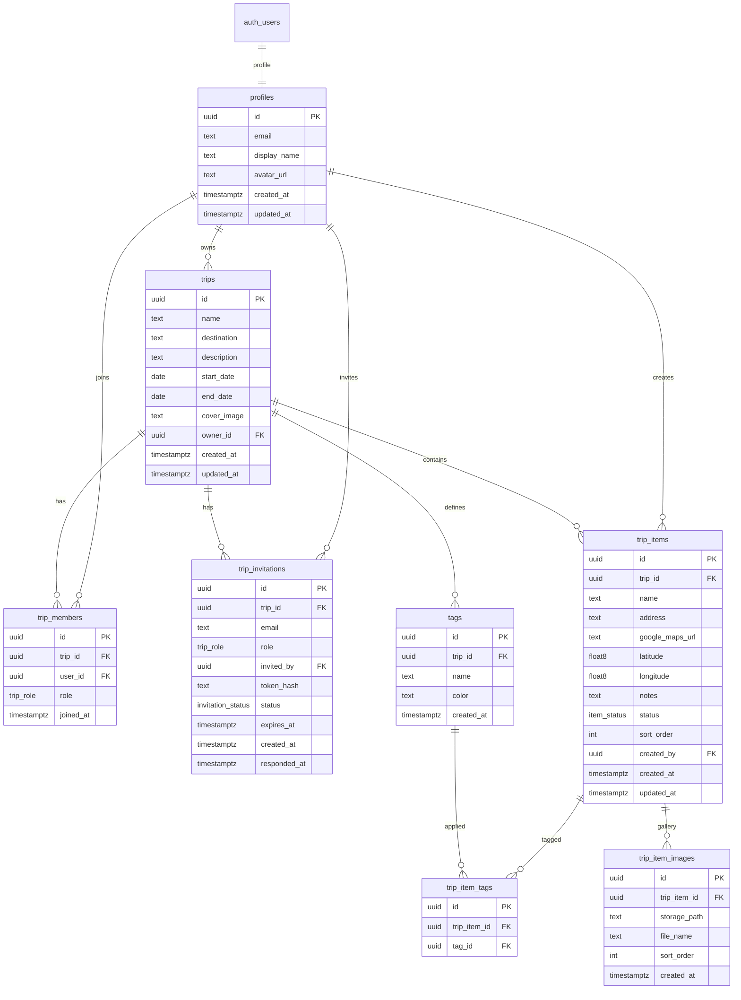

# Wanderlist — Architecture Overview

Wanderlist is a collaborative trip planner built with React, TypeScript, Vite, Tailwind CSS and Supabase.
It lets travelers collect places, organize them with tags and photos, and plan together in real time.

## 1. Goals

- A friendly, pastel, mobile-first planning experience (not a corporate dashboard).
- A functional MVP first: auth, trips, members, invitations, places, tags, images, maps links, realtime.
- Security enforced in PostgreSQL (RLS + triggers + SECURITY DEFINER RPCs), never only in the browser.
- Feature-based frontend architecture with strict TypeScript and no `any`.

## 2. High-level architecture

```
┌──────────────────────────── Browser ─────────────────────────────┐
│ React 19 + Vite + TypeScript                                     │
│                                                                  │
│  app/          providers, router, app shell                      │
│  features/     auth, trips, trip-members, trip-invitations,      │
│                trip-items, tags, images                          │
│  components/   design-system (ui) + shared compositions          │
│  lib/supabase  typed client, generated-style database types      │
│  services/     google-maps (Phase 1 URL builder / Phase 2 seam)  │
└───────────────┬──────────────────────────────────────────────────┘
                │ supabase-js (anon key only)
                ▼
┌────────────────────────────── Supabase ──────────────────────────┐
│ Auth (email/password, reset, magic link + OTP, sessions)         │
│ PostgREST (RLS-protected tables + RPCs)                          │
│ PostgreSQL (schema, triggers, helper functions)                  │
│ Storage (private `trip-images` bucket, signed URLs)              │
│ Realtime (postgres_changes on trip tables)                       │
│ Edge Function `invite-member` (service role + email delivery)    │
└──────────────────────────────────────────────────────────────────┘
```

## 3. Frontend layout

```
src/
  app/
    app.tsx                 – providers + routes
    providers/              – QueryClient, AuthProvider, Toaster
    router/                 – protected routes, route table
  components/
    ui/                     – buttons, inputs, modal, avatar, badges, states…
    shared/                 – AppShell, AuthShell, Logo, CoverImage, ViewToggle
  features/
    auth/                   – context, api, schemas, pages, profile, callback
    trips/                  – dashboard, trip CRUD, detail + settings pages
    trip-members/           – member list, roles, invite dialog
    trip-invitations/       – invite api/hooks, pending banner, token page
    trip-items/             – place list/cards, filters, DnD, place modal
    tags/                   – tag CRUD, manager, multi-select
    images/                 – compression, upload, signed URLs, lightbox
  hooks/                    – cross-feature hooks (realtime)
  lib/
    supabase/               – typed client, Database types
    env.ts, query-keys.ts, constants.ts
  services/
    google-maps.ts          – Phase 1 URL builder (isolated)
  types/                    – shared domain unions
  utils/                    – cn, dates, errors, tags, image compression
```

Every feature owns its **API functions, TanStack Query hooks, schemas, types and components**.
UI primitives never import features; features may import UI/shared.

## 4. State management

| State                | Owner                                   |
| -------------------- | --------------------------------------- |
| Auth session         | `AuthProvider` (Supabase listener)      |
| Server data          | TanStack Query cache                    |
| Forms                | React Hook Form + Zod                   |
| Filters/search/view  | Local component state (URL not required)|
| Realtime invalidation| `useTripRealtime` channel per trip      |

Realtime is used as a **cache invalidation signal**, not a state store. PostgreSQL remains the source of truth.

## 5. Data access strategy

- Base tables are queried with `select('*')` against a hand-written, generated-style `Database` type.
- Aggregate shapes (trip cards, members with profiles, items with tags/images) are composed
  in feature API functions from small, RLS-safe queries. This avoids fragile nested-select typing.
- Storage is **private**. Images are displayed with short-lived signed URLs (1 hour, refreshed by
  React Query stale time) so storage RLS is enforced.
- All privileged operations (invite creation, ownership transfer, invitation acceptance,
  reordering) are RPCs or Edge Functions that re-check permissions server-side.

## 6. Database ERD



### Integrity rules

- `trip_members` unique `(trip_id, user_id)`; exactly one `owner` per trip (partial unique index).
- `trip_invitations` unique pending invitation per `(trip_id, lower(email))`.
- `tags` unique `(trip_id, lower(name))`.
- `trip_item_tags` unique `(trip_item_id, tag_id)` and a trigger guarantees the tag and item share a trip.
- `trip_item_images` and `trip_item_tags` cascade with the item; items, tags, members, invitations cascade with the trip.
- `end_date >= start_date`, latitude/longitude ranges, normalized lowercase invitation email.
- `sort_order` defaults to the end of the list via trigger; `updated_at` maintained by trigger.
- Creating a trip auto-creates the owner membership and seeds the eight suggested tags.
- Ownership changes only through `transfer_trip_ownership()`.

## 7. Permissions model

Roles: `owner` > `editor` > `viewer`.

| Capability                        | Owner | Editor | Viewer | Non-member |
| --------------------------------- | :---: | :----: | :----: | :--------: |
| View trip / places / tags / photos|   ✓   |   ✓    |   ✓    |     ✗      |
| Create/edit/delete places         |   ✓   |   ✓    |   ✗    |     ✗      |
| Reorder places                    |   ✓   |   ✓    |   ✗    |     ✗      |
| Manage tags                       |   ✓   |   ✓    |   ✗    |     ✗      |
| Upload/delete photos              |   ✓   |   ✓    |   ✗    |     ✗      |
| Edit trip info / cover            |   ✓   |   ✓    |   ✗    |     ✗      |
| Invite / remove members           |   ✓   |   ✗    |   ✗    |     ✗      |
| Change roles / transfer ownership |   ✓   |   ✗    |   ✗    |     ✗      |
| Delete trip                       |   ✓   |   ✗    |   ✗    |     ✗      |
| Leave trip                        |   ✗*  |   ✓    |   ✓    |     ✗      |

\* The owner must transfer ownership before leaving; the trip can be deleted instead.

The full policy list is in [RLS_MATRIX.md](./RLS_MATRIX.md).

## 8. Google Maps integration

Phase 1 (implemented): `src/services/google-maps.ts`

- `buildGoogleMapsSearchUrl(address)` → `https://www.google.com/maps/search/?api=1&query=<encoded>`
- Accepts a pasted/edited URL when valid (`http`/`https`).
- Resolves a URL from URL → address → lat/lng, in that order.
- Phase 2 (Google Places Autocomplete) can be added entirely inside this service
  (plus a form picker) without touching place CRUD. No API key is shipped in Phase 1.
  **Phase 2 is intentionally not implemented until the MVP is verified.**

## 9. Key flows

### Passwordless email sign-in

1. User opens **`/login/email`** and submits an existing account email.
2. Frontend calls `supabase.auth.signInWithOtp` with `shouldCreateUser: false` and `emailRedirectTo=/auth/callback?redirect=<safe-path>`.
3. Local Supabase sends the magic-link email to Mailpit using `supabase/templates/magic_link.html`; the email includes both `{{ .ConfirmationURL }}` and a 6-digit `{{ .Token }}`.
4. The user either clicks the magic link (handled by `/auth/callback`, which waits for the Supabase session and then navigates to the safe redirect) or enters the 6-digit code on `/login/email`, which verifies with `supabase.auth.verifyOtp(..., type: 'email')`.
5. For security/UX, unavailable-email errors are treated as a neutral success state and post-auth redirects are restricted to same-origin internal paths.

### Invitation

1. Owner opens **Trip settings → Invite**.
2. Frontend calls Edge Function `invite-member` with the user JWT.
3. Function verifies owner, generates a random token, stores only its SHA-256 hash,
   upserts the pending invitation (7-day expiry) with the service role, and sends an email
   (Resend) when configured. In local/dev without a provider it returns the invite link.
4. Invitee can accept from the dashboard (`accept_trip_invitation_by_id`) or from the emailed
   link (`accept_trip_invitation(token)`). Both re-check the authenticated email, expiry and
   status, then create a membership atomically.
5. Owner can cancel a pending invitation (delete row). Invitations expire lazily.

### Realtime

Each trip settings page subscribes to `postgres_changes` on `trip_items`, `tags`, `trip_members`,
`trips` and `trip_invitations` filtered by trip id, plus item/tag-link/image tables.
Events invalidate the matching query keys, producing cross-member updates without manual state sync.

## 10. Assumptions

- The two reference chat screenshots were not attached to the request. The visual direction follows
  the written brief (soft pastel, rounded, friendly) with a coral/mint/cream palette.
- Email delivery uses Resend behind the Edge Function; if `RESEND_API_KEY` is absent, invite links
  are returned to the owner for manual sharing (safe for local development).
- Display avatars are generated from initials. `profiles.avatar_url` is reserved for future uploads.
- Phase 2 Google Places is deferred until the MVP is accepted.
- One owner per trip; transfer is explicit and atomic.
- A private storage bucket with signed URLs is preferred over a public bucket so image access
  follows membership permissions.

## 11. Testing

- **Unit/component:** Vitest + Testing Library in `src/**/*.test.ts(x)`.
- **Database/RLS:** local SQL smoke checks against Supabase (not part of `npm run test:run`).
- **End-to-end:** Playwright in `e2e/`. `e2e/support/local.ts` refuses non-local API URLs, `e2e/support/admin.ts` creates and removes unique test users with the local service-role key, and `e2e/support/email.ts` reads magic-link emails from Mailpit.
- E2E setup never resets the local database; it only removes users matching the `e2e.*@example.com` test prefix. Tests run serially because they share Mailpit and exercise realtime sessions.
